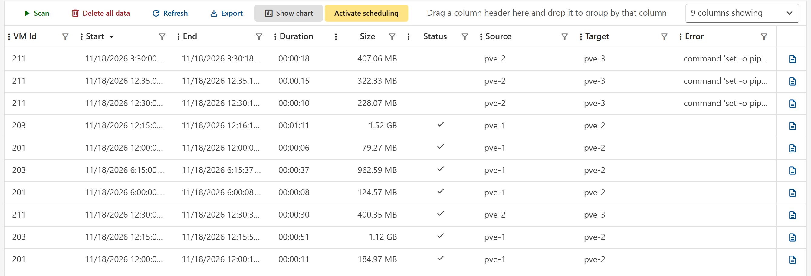
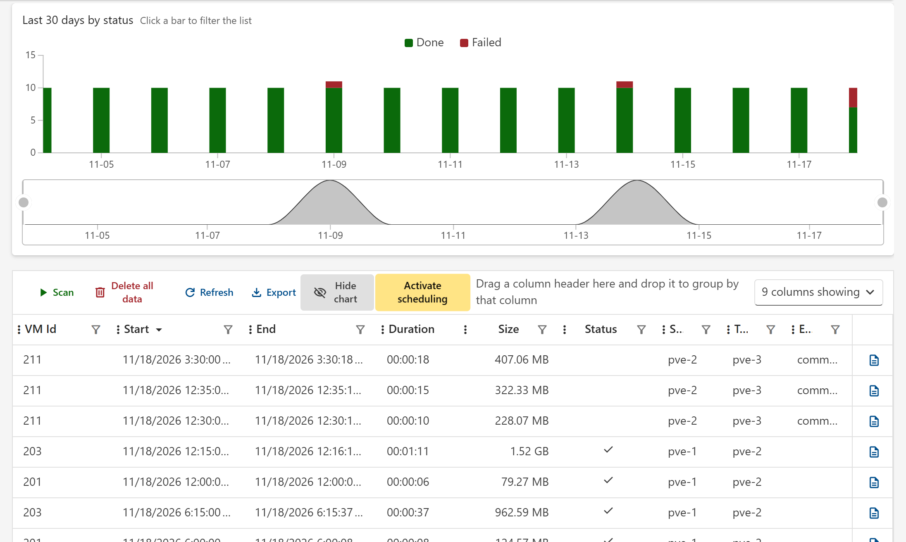

import Mdi from '~/components/Mdi.astro';
import PvePrivileges from '~/components/PvePrivileges.astro';
import ModuleIcon from '~/components/ModuleIcon.astro';
import FeatureGrid from '@corsinvest/cv4pve-docs-theme/components/FeatureGrid.astro';
import Tag from '~/components/Tag.astro';

<ModuleIcon name="sync" size="lg" /><Tag kind="per-cluster" />

Monitors Proxmox VE replication jobs across the cluster: status, trends, error patterns.

## Features

<FeatureGrid
  items={[
    { icon: 'mdi:shield-check', title: "Replication Status", text: "Monitor VM and CT replication job execution and success rates." },
    { icon: 'mdi:chart-line', title: "Performance Metrics", text: "Track replication size, duration, and failure patterns." },
    { icon: 'mdi:monitor-eye', title: "On-demand or scheduled scan", text: "Collect replication run history on demand or on a schedule using a cron expression.", href: '#collecting-data' },
    { icon: 'mdi:link-variant', title: "Proxmox VE Integration", text: "Works with Proxmox VE replication jobs via API." },
    { icon: 'mdi:timeline-clock', title: "Historical Data", text: "View replication trends over time for optimization." },
    { icon: 'mdi:tools', title: "Failure Logs", text: "Access detailed logs and error information for failed replication jobs." },
  ]}
/>

## Why

Why a dedicated view when PVE has its Replication tab?

<FeatureGrid
  items={[
    { icon: 'mdi:server-network', title: "Cluster-wide, not per-node", text: "The Replication tab of PVE is per node. This module shows every replication of the cluster on one page." },
    { icon: 'mdi:chart-line', title: "Trends, not just current state", text: "Charts over time show how size and duration change: data that PVE does not keep anywhere." },
    { icon: 'mdi:alert-circle', title: "Spot the silent failure", text: "The run history keeps the failed runs it collects, with status and error. You see a job that started failing last week without anyone noticing." },
    { icon: 'mdi:message-alert', title: "Failure context, not just status", text: "Each failed run has its error message. You find out why it failed without an SSH session on the source node." },
  ]}
/>

## Sections

- **Overview**: introduction to the module and its dashboard widgets
- **Replications**: history of the replication runs collected by the scans. The columns are VM ID, start, end, duration, size, status, source and target node, and error; **Task Id** and **Last Run** are hidden and can be added from the column picker. When the list is grouped, the header of each group shows how many rows it has and their total size. On each row, **Show log** opens the log of the run. See [Collecting data](#collecting-data) for the scans and the toolbar actions
- **Scheduled**: configured replication jobs with schedule, rate limit, last sync and next sync
- **Trends**: line charts of replication **Size** and **Duration** over time, one line per guest. Choose the **Period**, then the **Node**, then the **VM / CT** to plot. **Period** is a single date range field, limited to the dates for which data exists

## Collecting data

**Replications**, **Trends** and the dashboard widgets work on data that a scan copies from Proxmox VE into the module database. **Scheduled** reads the cluster live and needs no scan.

A scan reads the replication jobs of every online node. For each job, it stores the last run with its log, if that run is not in the database yet. A run that failed is stored too, with its error: a job that keeps failing gives one record for each try a scan finds. It then deletes the records older than **Max days logs**.

:::caution[Runs between two scans are not recorded]
A scan reads only the last run of each replication job. If a job replicates more often than the scan runs, the runs in between are missing from the history. Keep the scan schedule at least as frequent as the most frequent replication job.
:::

Toolbar of the **Replications** page:

| Action | What it does |
|--------|--------------|
| **Scan** | Starts a scan immediately in the background. Progress and log are in the global Task Tracker |
| **Delete all data** | After confirmation, deletes every collected record of the cluster from the module database. Replication jobs and replicated data in Proxmox VE are not touched |
| **Refresh** | Reloads the grid |
| **Export** | Downloads the grid as an Excel file |
| **Show chart** / **Hide chart** | Shows or hides the chart above the list. See [Daily chart](#daily-chart) |

The toolbar also shows the state of the schedule configured in the settings: with **Enable scheduling** on, an info icon with **Next Execution** (the date of the next scan) and the schedule in words; with it off, the **Activate scheduling** button, which opens the settings, for the users who can change them. When the list is empty, the grid offers **Execute your first scan** to the users who can use **Scan**.

### Daily chart

**Last 30 days by status** has one column per day, split into **Done** and **Failed** runs. It is hidden when the page opens.

- Drag the range bar under the chart to filter the list on those days. The bar appears when the chart has at least 2 days
- Click a column to filter the list on that day and status. The button with the day and the status, beside the title, removes the filter
- **Hide chart** removes the filter too

The days of the chart are counted in UTC, while **Start** is in local time: near midnight a run can fall on another day in the chart.

## Widgets

| Widget | Content |
|--------|---------|
| **Status** | Replication status |
| **Size** | Replication size |
| **Check** | Failed replications in the last days |
| **Info** | Replication overview |
| **Daily Status** <Tag kind="ee" /> | Successful and failed replications per day (last 14 days) |

The **Check** widget has one widget setting, **Days to analyze** (default 30, like **Max days logs**: older records are already deleted, so a longer period shows nothing more). It covers the clusters where **Enable scheduling** is on, and those where a scan was started by hand. It shows "Module not configured!" only when no cluster has the schedule on and no scan was ever made.

## Settings

| Setting | Default | Purpose |
|---------|---------|---------|
| **Enable scheduling** | off | Turns the scheduled scan on or off. With it off nothing runs by itself on the cluster; **Scan**, started by hand, stays available |
| **Cron Schedule** | `*/5 * * * *` [<Mdi name="open-in-new" />](https://crontab.guru/#*/5_*_*_*_*) | When the scheduled scan runs (default: every 5 minutes) |
| **Max days logs** | 30 | How many days of collected replication data to keep (minimum 1). Older records are deleted at the end of each scan |

## Permissions

Assign these to a role under [Security](../../configuration/admin-area/security/#permissions).

| Permission | Allows |
|------------|--------|
| **Replication Analytics** | Open the module and its **Overview** page |
| **Replications**, **Scheduled**, **Trends** | Open the page with that name (one permission per page) |
| **Status**, **Size**, **Check**, **Info**, **Daily Status** <Tag kind="ee" /> | Use the dashboard widget with that name (one permission per widget) |
| **Replication: Export** | Export the list of the **Replications** page |
| **Replication: Scan** | Use the **Scan** button |
| **Replication: Delete all data** | Use the **Delete all data** button |
| **Edit Settings** | Change the module settings |

The built-in role of the module includes all of them. A custom role has to be given them explicitly: without the permission the button is hidden.

The module also follows the cluster permissions (**VM: Read** and **Node: Read**, see [Security](../../configuration/admin-area/security/#permissions)):

- **Replications** and **Trends** list only the VMs the user can read; the source and target nodes stay visible next to the VM. The nodes offered by **Trends** are only the readable ones.
- **Scheduled** lists only the replication jobs of the VMs the user can read.
- **Scan** and **Delete all data** need **Read** on every VM, node and storage of the cluster: without it the buttons are hidden.
- The widgets and the **Overview** count all the VMs of a cluster: they are shown only on the clusters where the user can read every VM, node and storage.

<PvePrivileges module="replication-analytics" />
